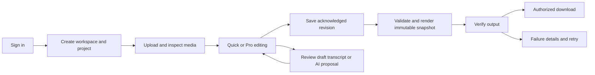

# User journeys and workflows

**Status:** Proposed. **Owner:** Product designer. **Dependencies:** [permissions](user-roles-and-permissions.md), [Quick](../02-ux-ui/quick-edit-experience.md), [Pro](../02-ux-ui/pro-editor-and-timeline-interactions.md).

1. **First export:** Create project with name, aspect ratio and rational frame rate; upload media; see preparation status; assemble and preview clips; add captions/branding if desired; save; choose explicit export settings; confirm usage; observe job and download. If offline, changes are marked unsaved; a conflict offers compare, reload or save a copy.
2. **Switch modes:** Save or retain local pending command; switch view without conversion; Quick displays a banner for tracks/effects it cannot edit. Pro-only data persists and can still render. Do not overwrite it when modifying a representable property.
3. **Caption review:** Select source and language, disclose provider and estimated usage, submit; on completion open timestamped text and review each low-confidence cue; split/merge/edit timings; preview safe area; choose sidecar or burned delivery.
4. **Review:** Editor grants an expiring revision-scoped review link. Reviewer opens only that revision, seeks, adds a timecoded comment; editor resolves against that revision. Revoked links immediately stop new authenticated access; signed artifact links remain subject to their TTL.
5. **Recovery:** Interrupted upload resumes verified missing chunks. Failed render retains snapshot and safe diagnostic; retry creates a new attempt with idempotency and quota reconciliation. Missing asset blocks affected output with relink or remove choices; never substitute silently.

Acceptance: each flow works with keyboard, announces progress and errors, and survives reload with committed changes intact. Trial users should verify labels and recovery flows before scope freeze.
