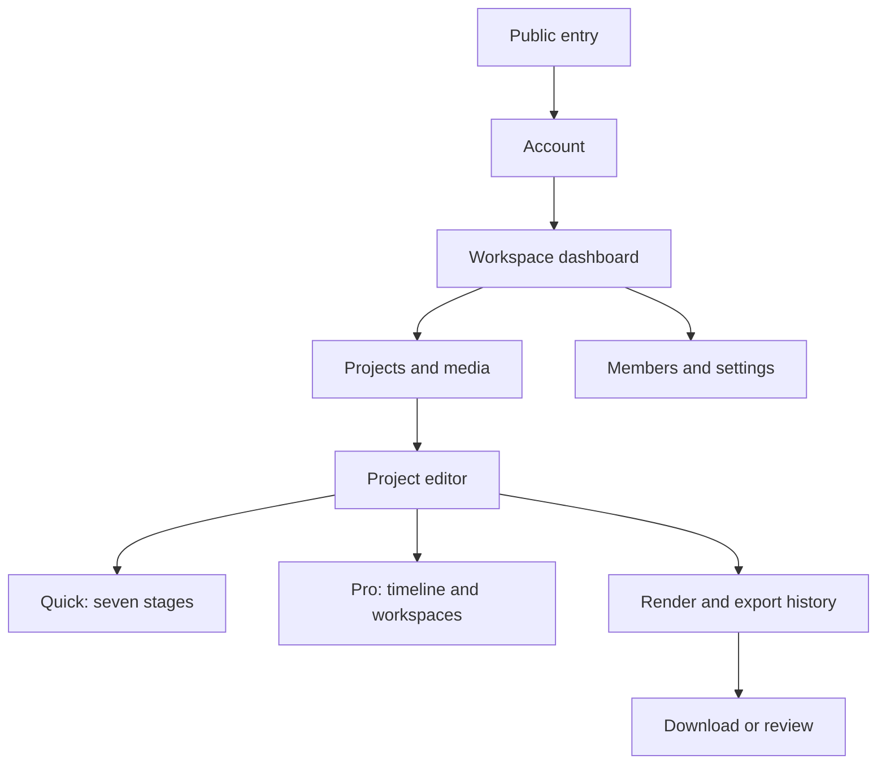

# UX strategy and information architecture

**Status:** Proposed. **Owner:** Principal product designer. **Related:** [personas](../01-product/personas-and-jobs-to-be-done.md), [screen inventory](navigation-and-screen-inventory.md), EDT-001/002.

Design for a first export without losing access to professional control. Workspace context is always visible; destructive actions describe their consequences. Separate product navigation from editor navigation. A single project has one canonical composition, with Quick and Pro views. Advanced material unsupported by Quick is preserved, counted and disclosed; a user can open Pro to inspect it. Never hide a changed render result behind a reassuring simplified preview.

Prioritize clear system state: upload, processing, unsaved, conflict, render and verification must be visible. Progressive disclosure applies to expert controls, not security, cost or irreversible consequences. Keep a textual keyboard-accessible alternative to direct canvas manipulation. Project and workspace names disambiguate context before exports or shares. Research acceptance: users in representative novice and professional tests can identify current workspace, recover a failed upload, find their saved revision, and distinguish an approximate preview from a final verified result.
