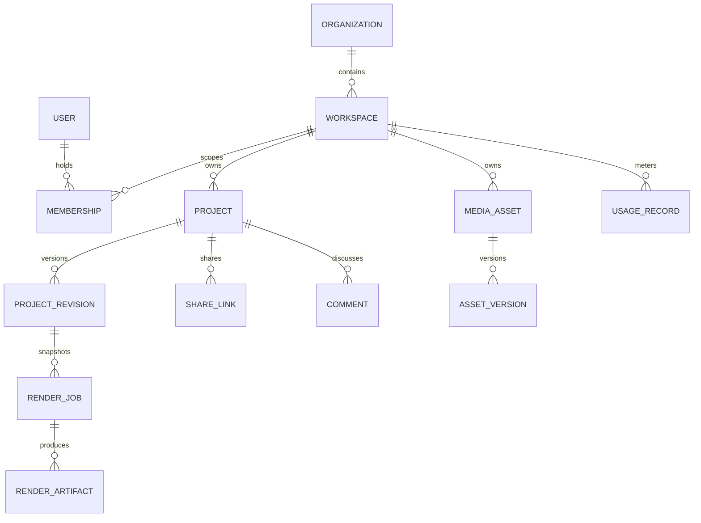

# Domain model and relationships

Status: proposed • Owner: data architect • Dependencies: [schema](../03-frontend/canonical-editor-state-and-schema.md).

Sequences, tracks, clips, effects, caption tracks/cues, audio tracks and thumbnail are structured inside immutable revision JSON; validated indexes for search can be projections and rebuilt. BrandKit is workspace-scoped and versioned. UploadSession binds workspace, actor, object key, parts and expiry. AIJob and RenderJob reference immutable inputs and usage reservations. BillingAccount and Subscription belong to organization/workspace billing boundary, separate from membership. Notification belongs to user; AuditEvent records actor, action, scope and result. IDs are UUIDs, foreign keys include tenant ID where appropriate; soft delete and retention policy apply. Authorization always precedes access; indexes must not expose data across scopes.
