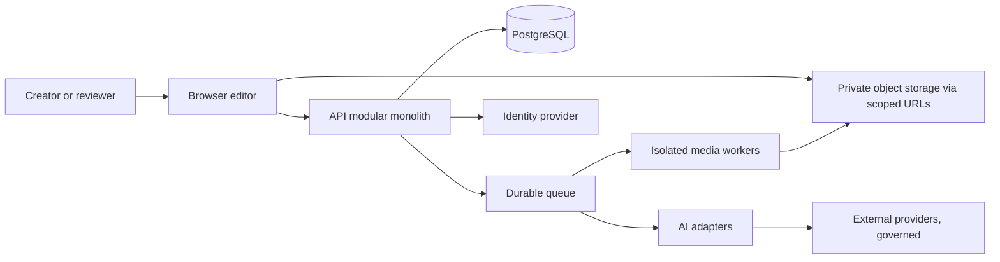

# System context and containers

Status: proposed • Owner: principal architect • Dependencies: [boundaries](service-boundaries-and-data-flows.md), [deployment](deployment-architecture.md).

All components are proposed. Browser holds ephemeral state and authorized proxy data; API owns authorization and transactions; worker processes isolated media against immutable snapshots. External speech/AI providers receive only approved minimal inputs. No browser or third-party provider has direct database access. Threat boundaries: public ingress, tenant-scoped application, worker sandbox and provider egress. Scope and assumptions are in [governance](../00-governance/assumptions-and-open-decisions.md).
